# The mode plugin, explained

A guide for someone meeting this for the first time. It assumes you have it installed; if not, the [README](README.md#install) covers that in about two minutes.

Every diagram below is a committed SVG that follows your system theme, so it reads on a light or a dark GitHub.

---

## The big picture

A Claude Code session has no memory of instructions you gave it forty turns ago. Not because it forgets exactly, but because your early message keeps sliding further back until it stops carrying weight against everything that came after.

This plugin fixes that by never relying on memory in the first place.

> Think of a kitchen. The **mode** is how the kitchen runs, whether that is a careful tasting menu or a rush service. The **style** is how the waiter talks to you, warm and chatty or clipped and efficient. Neither one decides the other, and a new waiter does not change the recipe.

Those are the two dials. A session holds one of each, and each one holds until you drop it.

---

## The two axes

A **mode** answers _how the work runs_: it has steps, gates and a point where you can say it finished. A **style** answers _how it sounds while running_: it has no steps at all, and instead changes the texture of whatever mode is going.

<p align="center">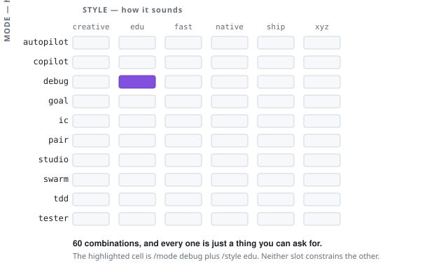</p>

Keeping them apart is what keeps the file count down. Eleven modes and six styles cover sixty-six combinations, so a new way of talking costs one file rather than nine rewrites.

**The test for which one a new idea is:** does it have an order of operations? If it says do this, then that, and stop here, it is a mode. If it only changes the texture of what you were already doing, it is a style.

That test is why the diagrams below come in two shapes. Every mode is drawn as a pipeline, because it has one. Every style is drawn as a transformation of the same reply, because a style has no steps and drawing it as a flow would misrepresent what it is.

---

## How it actually holds

A `UserPromptSubmit` hook runs _before_ Claude reads your message. It performs any switch you asked for, so the slot is already set by the time Claude sees anything, then injects the contract text into the prompt itself.

<p align="center">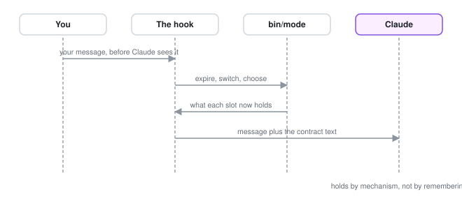</p>

What gets injected depends on whether the session is starting or already running:

<p align="center">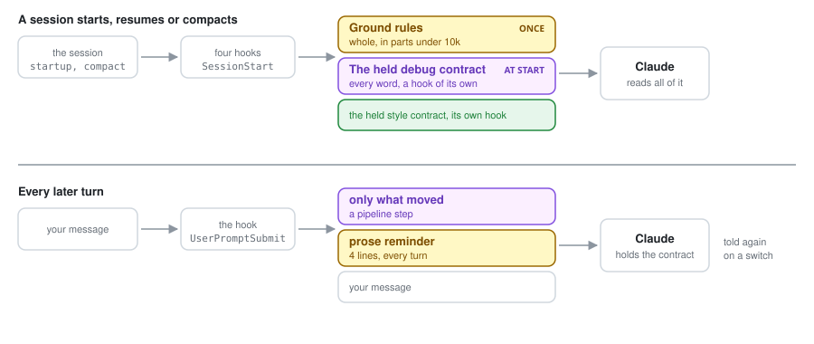</p>

So Claude is told a contract once, whole, and **told again the moment it changes**: a switch arrives as a line naming the contract it replaced followed by the new one, and a slot turned off arrives as a line saying its contract no longer applies. A resume, a clear or a compact drops the injected text, so the start hooks send the ground rules and every held contract again before the next prompt. Each of those is a hook of its own because Claude Code caps a hook's text at 10,000 characters, and a hook over that hands Claude a file to read instead.

### The pipeline is told again too

Every mode declares its steps in front matter, `steps: read, fork?@question, ground, …`, and that pipeline is what the status line draws. It is also state. `mode mode step` answers where you stand, and the same answer is injected on the turn it moves:

```text
Pipeline, step 3 of 7: ground.
Done: read, fork. Next: shape.
Record with `mode mode done ground`, or say which step you are on.
```

A step advances two ways. The `@event` suffix names the moment that closes it, and most of those are observable, so a hook records them from the tool call itself: asking you a question, spawning an agent, writing an artifact, running a test, going red, committing. Nobody has to remember. Steps with no event are the thinking ones, and those are declared, which is what the injected line asks for. A diagram that stops moving is therefore either work that stalled or a step nobody recorded, and the line above tells you which.

A contract body can run to any length, because it is read once and comes again only on a switch, a resume or a compact. A standing reminder is still capped at four lines, because it is what the hook's preview carries when an injection runs over Claude Code's 10,000-character cap, and the one block that does repeat, the outranking rule's, is rationed the same way.

### A switch on its own never reaches Claude

Type `/mode debug` and nothing else, and the hook does the switch, prints the chips back to you, and ends the turn there. No request is made, so it costs nothing and answers in about a quarter of a second. A bare `/mode` or `/style` answers with that axis's contracts instead, the way `/model` lists models.

The moment your message carries anything beyond the switch, the turn runs normally. `/mode debug fix the parser` sets the slot and then goes to work, and so does a message with another plugin's command in it. The rule is simply whether a word is left over that only Claude can answer.

The contract is not spent on the turn that never ran. `/mode debug` on its own defers the whole contract to your next real message, which is the first turn that has any use for it.

The confirmation closes with "Set. The status line catches up when the conversation continues." That is not a caveat, it is the answer to the question you are about to ask. Claude Code redraws the status line off the model's reply, and a turn ending in the hook never writes one, so the chips printed back to you are the current ones and the line below follows on your next message.

---

## Ground rules, the third kind of file

Beside the two slots sits a set of files that are not switched at all. They live in `skills/mode/rules/`, layered under `~/.claude/mode/rules/`, and they are **always on**.

<p align="center">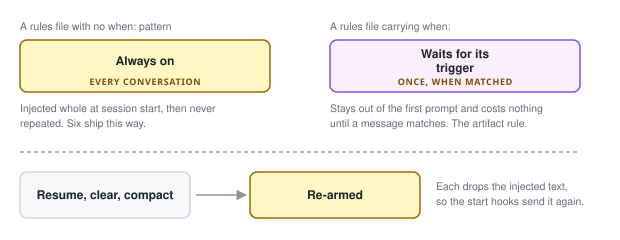</p>

Seven ship with the plugin:

| Rule            | What it holds                                                                                                                                                     |
| --------------- | ----------------------------------------------------------------------------------------------------------------------------------------------------------------- |
| `evidence`      | Claims rest on something read this session; receipts over narration; honest confidence                                                                            |
| `scope`         | The diff stays inside the ask; fix causes, not symptoms; docs move with the code                                                                                  |
| `board`         | Autonomous work runs on a visible task board, and a ticked box is a receipt                                                                                       |
| `collaboration` | Execute what is reversible, escalate what is genuinely yours, challenge by default                                                                                |
| `prose`         | Write like a colleague typing to a colleague: the fact that settles it, then stop; no em dashes, symbols or chat formatting. Outranks every mode, style and skill |
| `artifact`      | Scoped: fires only when a page is on the way, carrying the theming and interactivity contract                                                                     |

**Why this tier exists is economic.** A rule in a `CLAUDE.md` is paid for on every request of every session. A ground rule costs one injection per conversation.

A rules file needs only `name` and `summary` in its front matter. Drop a file with the same name into your own rules directory to replace a shipped one, or one with an empty body to silence it.

**One rule outranks every contract.** A teaching style once talked Claude into glossaries and recaps the prose rule forbids, because the contract's voice outlasted a rule told once. A rules file carrying `outranks: contracts` closes that gap: its own `## Standing reminder` is restated on every turn, after anything the mode and the style sent, under a line saying it wins wherever they disagree. `prose` is the one that ships with it, so human prose holds in every mode, style and skill.

---

## Starting and stopping without typing

Typing a name is not the only way in, and `off` is not the only way out.

<p align="center">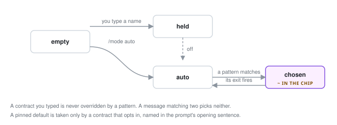</p>

| Key                    | Means                                                                                                                                                                                       |
| ---------------------- | ------------------------------------------------------------------------------------------------------------------------------------------------------------------------------------------- |
| `enter-when`           | Alternatives split on a vertical bar. One matching your message selects this contract, but **only while that slot is set to `auto`**, or holds a pin and the contract sets `enter-over-pin` |
| `enter-over-pin: true` | A pinned default is no bar: one of its `enter-when` phrases in the prompt's opening sentence takes the slot. A name you typed still is                                                      |
| `style: <name>`        | The style this mode runs in, put in place whenever it is entered unless you typed a style in this conversation. `dispatcher` runs in `fast`                                                 |
| `enter-never: true`    | Never chosen for you, must be typed. Only `autopilot` carries it                                                                                                                            |
| `exit-when: manual`    | Only `/mode off` ends it                                                                                                                                                                    |
| `exit-when: approved`  | A yes was recorded with `/approve` under this contract                                                                                                                                      |
| `exit-when: mr-opened` | A merge request exists for the branch it worked on                                                                                                                                          |

Matching anchors at the **start** of a word and runs free at the end. So `fail` covers fails, failed, failing and failure, while `build the` never matches "rebuild the". That missing trailing boundary is deliberate, and it is why every alternative has to be verb-shaped: a bare `build` would fire on "the build fails on startup" and hand a broken pipeline to the mode that spawns a team.

---

## Pins, or the answer that is the same every time

A slot dies with the conversation, which is correct for a contract you set for one piece of work. It is wrong for the answer that never changes: this repo belongs to other people, so `native`; that one goes out to dependents, so `ship`. Retyping it every morning is exactly the memory problem the plugin exists to remove, moved up one level.

A **pin** is that answer written down once. It fills a slot at the start of every conversation held inside a directory, and nothing else.

```bash
mode style pin native          # here and everywhere below here
mode pins                      # what a fresh conversation would start in, and which file said so
```

Two layers answer, and which one you reach for is a question about who the answer is for.

| Layer        | Written by                                                      | Reaches                 |
| ------------ | --------------------------------------------------------------- | ----------------------- |
| **Personal** | `mode <axis> pin <name>`, stored in `~/.claude/mode/pins.tsv`   | You, on this machine    |
| **Shared**   | a `.mode` file committed in the repo, two lines of `axis: name` | Everybody who clones it |

Lookup walks up from the working directory and takes the first answer it finds, so a package deep in a monorepo can pin something the repo root does not. In one directory the personal layer beats the shared one, because your machine outranks somebody else's default. `mode <axis> pin off` is a personal no that masks a shared file without editing the repo, and `--forget` removes it again.

**What keeps a pin from becoming an override** is three restraints, and each one exists because the alternative is worse:

- A slot you typed into is never adopted over. So is one you turned off, for the rest of that conversation. Without this, `/mode off` in a pinned directory would be undone by your next message.
- Adoption happens once per axis per conversation. Without this, every switch you made would be reverted on the next prompt.
- A name this machine has no contract for is skipped rather than held, and it does not take the rest of the file with it. So a repo pinning somebody else's private contract costs a stranger nothing.

The status line tells the three sources apart: `native` you typed, `~native` the chooser picked, `=native` the directory pinned.

---

## `/why`, the window into all of it

Every mechanism above is invisible by design. The contract is injected where you cannot read it, the gates only announce themselves by refusing something, and the chips have room for a name and nothing else. So there is one command that shows the whole state:

```text
/why
```

Like a switch, it is answered inside the hook and never reaches the model, so it costs nothing and returns immediately. It prints five things:

| Section                     | Answers                                                                                    |
| --------------------------- | ------------------------------------------------------------------------------------------ |
| **Slots**                   | What each holds, and whether you typed it, the chooser picked it, or a directory pinned it |
| **Pipeline**                | Which step the held mode is on, what is behind it and what is next                         |
| **Gates**                   | Every flag the mode declares, whether it is open right now, and what would open it         |
| **Ground rules**            | Which have been injected already, and which are still waiting on a trigger phrase          |
| **The next prompt carries** | Whether your next message costs the whole contract or the four standing lines              |

The Gates section is the one worth knowing about before you need it. A guard refusing an edit reads like the tool being broken until you have seen the line that says which gate it was and what opens it.

---

## The eleven modes

Each one is a pipeline. A yellow box is a gate, meaning the work genuinely stops there. A dashed line is a loop back.

### `pair`

The default. Claude keeps its hands on the whole loop and hears two views that are built to differ. A teammate named `director`, spawned on Opus whatever model Claude runs on, owns the outcome as design director, product director or tech lead, and forms its view from the work itself rather than from Claude's account of it. It is the second pair of eyes on decisions, reading the diff and the code to judge the work as a whole, while every detail and its verification stay Claude's, so it never reviews line by line or runs a test, build or typecheck. Claude Code's `advisor` tool, when the session has one, reads the whole transcript and checks the method against the evidence. What to build and the final sign-off go to the director, how to build it and whether the receipts are real go to the advisor, and on a split over direction the director's answer stands. Both weigh in before anything is built and again before anything is committed. Neither touches the code or talks to you, and a sign-off is never your yes. Two guards hold it: `director-guard` denies the director any write, spawn, board item, git write, or test, build, typecheck, lint or background run, and `pair-guard` denies a commit over 30 changed lines until the director has answered after Claude's last edit.

<p align="center">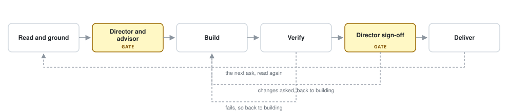</p>

### `ic`

The same loop as `pair` without the director, for when a second reader would cost more than it saves. One senior pair of hands runs the whole loop while you stay in the room, borrowing each specialist's discipline without the ceremony.

<p align="center">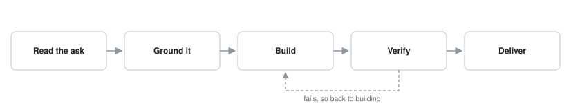</p>

### `copilot`

For work that splits into several independent domains. You refine it together, then a team builds it while you watch. This is the one mode with a real enforced gate.

<p align="center">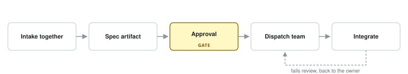</p>

### `swarm`

The same team, reached without a spec. Instead of agreeing a plan and dispatching against it, you keep a standing roster of owners, one per domain, and every ask is routed to whoever owns that domain. When nobody does, one is hired. The gate that replaces the approval is triage: an ask too unclear to route is refused rather than guessed at, since with no spec there is nothing to catch a wrong read before the work starts.

<p align="center">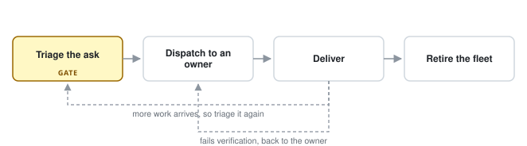</p>

### `autopilot`

You want a result and you are walking away. It is the same pipeline with the human gate removed, which is exactly why it can never be chosen for you and has to be typed.

<p align="center">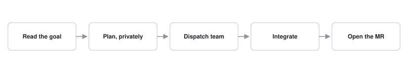</p>

### `debug`

Something is broken and nobody knows where. The gate is the important part: nothing moves forward on a bug that has not been seen failing.

<p align="center">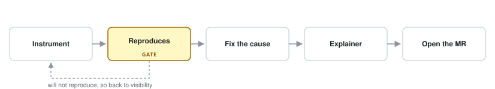</p>

### `tdd`

No implementation line exists before a test that failed for the right reason. Red means the assertion fired, not that the file failed to import.

<p align="center">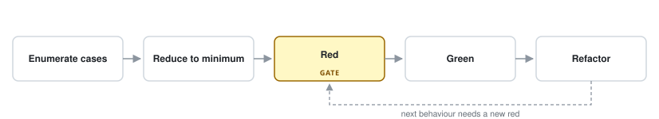</p>

### `goal`

For when "it works" is only half of done. A channel is anything that can disagree with you: a response body, a log line, an exit code. Reading the code is not one, and neither is your own opinion of your diff, which is why the audit goes to fresh eyes.

<p align="center">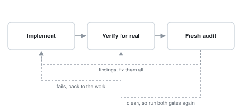</p>

### `dispatcher`

Several requests at once, each triaged into one of three outcomes: a new conversation for work nobody holds, a relay to the live session that already holds it, or an answer right here when a look settles it. Each outcome starts from `mode triage`, which asks Jev, a yes-or-no judge on OpenRouter, and matches the request against every live session. It writes every prompt itself in your voice, starts new sessions in `~/Notes` on Sonnet at xhigh effort told to spawn an Opus medium director, and never waits on a reply. It never writes either: `router-guard` denies `Write`, `Edit` and `NotebookEdit` while it is held, and nothing it produces is a deliverable. The conversation is titled as the dispatcher, never after a request it routes.

<p align="center">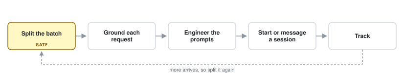</p>

### `tester`

A feature somebody else built needs sweeping. It ends in a verdict and fixes nothing, because a tester who fixes is reporting on their own work.

<p align="center">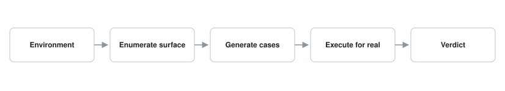</p>

### `studio`

Thinking something through, where the thinking itself is the deliverable. The only mode that is a cycle rather than a pipeline.

<p align="center">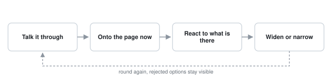</p>

---

## The six styles

A style has no steps, so each is drawn as what it does to the same reply: on the left what it would have been, on the right what it becomes.

### `edu`

You want to understand rather than be updated, and you want it explained the way a friend who knows the subject would tell you.

<p align="center">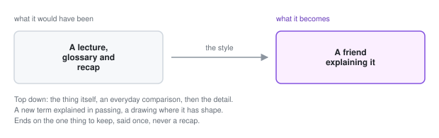</p>

### `fast`

You are in a hurry. Note the third line: fewer words never means less work.

<p align="center">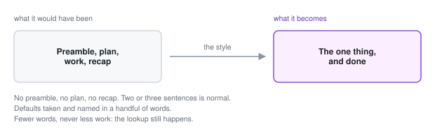</p>

### `ship`

It is going out and somebody else has to maintain it, so the change cannot travel alone.

<p align="center">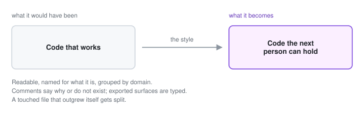</p>

### `native`

Somebody else's codebase, where your conventions are not welcome.

<p align="center"></p>

### `creative`

The safe first answer is not good enough. The last line is the boundary that keeps it usable.

<p align="center">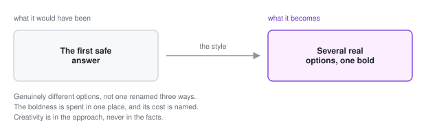</p>

### `xyz`

You write short and expect the rest inferred.

<p align="center">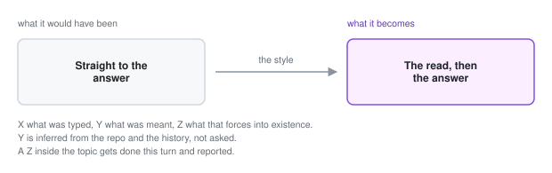</p>

---

## A worked example

Say you want a careful debugging session, explained as you go, because you are learning the codebase.

```text
/mode:debug /style:edu
```

Both land in one message. On that prompt Claude receives the ground rules whole, the entire `debug` contract, the entire `edu` contract, and your message. On a turn where nothing moved, it receives only this:

```text
Ground rule prose, which outranks any mode, style or skill that says otherwise.
- Write every sentence like a colleague typing to one they like: the settling fact first, then stop, with no recap and no offer to do more.
- Join related facts with because, so and which instead of chopping them into verdict lines, and never announce what comes next.
- Chat scans with spacing and bold on a few words, bullets only for parallel items and never one opening on a bold label. A message to anyone else stays plain paragraphs.
- No em dash or spaced dash between clauses, no symbols in prose, sureness said through the verb, and nothing casual added to sound human.
```

Five lines, the prose reminder, so it has the final word. That is the whole ongoing cost. A turn where the pipeline moves adds its position line under `Active mode: debug`, and a switch to another mode adds a line naming `debug` as the contract it replaced, then the whole new one.

When you eventually type `/approve <slug>` on the explainer, `debug` reaches its exit condition and clears itself. The `edu` style is untouched, because the axes never read each other.

---

## What is actually enforced

Worth being blunt, because a contract that asks politely and a gate that refuses are different things.

Two flags have a mechanism behind them, and any contract can declare either.

| Flag                           | What it refuses                | What opens it                                                                  |
| ------------------------------ | ------------------------------ | ------------------------------------------------------------------------------ |
| `no-dispatch-without-approval` | Spawning a teammate            | A yes recorded with `/approve`, scoped to the mode that asked                  |
| `no-code-without-red`          | Editing an implementation file | A suite the recorder watched exit non-zero, until a passing run closes the lap |

`copilot` carries the first, `tdd` the second. The second is narrow on purpose: it judges only files whose extension carries behaviour, outside a test directory, whose name is not test shaped. The test itself, prose, config and fixtures are never refused, because a rule that blocked those would block the only route to a red.

It also cannot tell a red from a broken test, since an import error exits non-zero too. It stops the failure that actually happens, which is skipping the test entirely.

Everything else rests on Claude being reminded every single turn, which is genuinely useful and is not a guarantee. The clearest remaining gap is `no-implement`: `copilot` declares it and no hook reads it, because no hook can tell a two-line seam between two finished domains from a domain somebody decided to build themselves.

Separately, **guards** ship in `hooks/guards/`, fencing the ground rules: the board fences, the prose fence, comment, null, red and shell-write guards. One switch disarms them all, `"guards": "off"` in `~/.claude/mode/config.json`, with absent meaning armed, and `"disarm": ["board-check"]` in the same file turns off only the guards it names, by file stem. The approval gate sits outside that switch, in `hooks/gate.ts`, and `/why` says which of the two you are looking at.

---

## Writing your own contract

One markdown file in `~/.claude/mode/modes/` or `~/.claude/mode/styles/`, live as soon as you save it. The [README](README.md#writing-your-own) has the front matter table. Two things catch people out.

**A flag is on whenever the key is there and does not say no.** So `true`, `yes`, `1` and even a typo all count as on. It is off only when absent, empty, or one of `false`, `no`, `off`, `n`, `0`. That direction is deliberate: every flag is an opt-in restriction, nobody writes one meaning to leave it off, so a value that cannot be read lands with the restriction **on** rather than silently off.

**Write the standing block in the voice it is read in.** It gets injected into Claude's own prompt, so "the user speaks only to you, and no teammate writes to them" is a rule, while the same sentence turned around states the opposite one.

Then run `mode sync`, which rewrites the registries and writes the contract's palette entry so none of them drift from what is on disk.

The diagrams in this guide are generated by `node scripts/draw-contracts.ts`, so adding a contract means adding its entry there and re-running it.

---

## In short

- **Two slots**, one for how the work runs and one for how it sounds, independent in both directions.
- **A hook, not memory.** The contract is injected whole on the turn you switch, and again only when it changes, so a held contract costs nothing per turn.
- **A third tier**, ground rules, always on and injected once per conversation.
- **`auto`** lets contracts be chosen from what you write, with a tilde marking anything you did not type yourself.
- **A pin** is the answer that never changes, held by a directory rather than by a conversation, marked with an equals sign.
- **`/why`** shows the whole state at once, and costs nothing to ask.

If you remember one thing: **it holds by mechanism rather than by the model remembering it**, and that single property is what makes the contract still true on turn forty.

Next, the [README](README.md#the-modes) has the quick table of what each mode and style is for.
